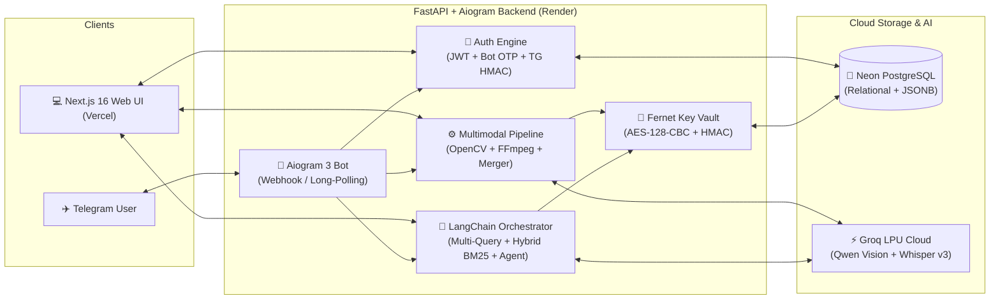

# 🎬 WhAppend — Multimodal AI Media Intelligence & Telegram Assistant

An end-to-end multimodal intelligence platform that integrates **Groq LPU Vision & Whisper**, **LangChain Agentic RAG**, **Telegram Bot API (`aiogram`)**, and **Neon Serverless PostgreSQL** with a full-stack **Next.js 16** workspace.

It allows allowlisted users to upload or forward **Videos, Audio/Voice Notes, and Images** from either the Web or Telegram, automatically extract timestamped visual and spoken events, generate structured AI chapters, and query their media library using their own encrypted **Bring Your Own Key (BYOK)** Groq credentials.

---

## 📸 See It Working

### 1. ✈️ Multimodal Telegram AI Bot & BYOK Assistant

Allowlisted users can interact with WhAppend 24/7 directly inside Telegram. Users verify their phone number once, configure their personal Groq API key (`/setkey`), and can either chat freely with the LLM, send videos/voice notes/photos for automatic timeline extraction, or query media previously uploaded on the Web.

```text
┌─────────────────────────────────────────────────────────────────────────┐
│ 💬 Telegram Bot Conversation Flow                                       │
├─────────────────────────────────────────────────────────────────────────┤
│ 👤 User:                                                                │
│ "/start"                                                                │
│                                                                         │
│ 🤖 WhAppend Bot:                                                        │
│ "👋 Welcome to WhAppend AI!                                             │
│  Access is restricted to allowlisted phone numbers (BYOK).              │
│  Tap [📱 Share my phone number to verify] or send /verify +55..."       │
│                                                                         │
│ 👤 User:                                                                │
│ [Shares Verified Contact: +55 22 99918-5035]                            │
│                                                                         │
│ 🤖 WhAppend Bot:                                                        │
│ "✅ Phone verified! (+5522999185035)                                    │
│  Next step: send /setkey gsk_your_key_here to configure your BYOK key." │
│                                                                         │
│ 👤 User:                                                                │
│ "/setkey gsk_9f8a7b6c5d4e3f2a1b0c...tjYL"                               │
│ (🗑️ User message is automatically deleted by the bot for security)      │
│                                                                         │
│ 🤖 WhAppend Bot:                                                        │
│ "✅ Groq API Key Verified & Encrypted!                                  │
│  Stored key: gsk_••••tjYL (Fernet AES-128-CBC + HMAC)                   │
│  Send any message to chat, or send a Video, Voice Note, or Photo!"      │
│                                                                         │
│ 👤 User:                                                                │
│ [🎥 Sends a 45s meeting clip + caption: "When did he show the chart?"]  │
│                                                                         │
│ 🤖 WhAppend Bot:                                                        │
│ "✅ Video Ready! (meeting_clip.mp4)                                     │
│  • Extracted 14 timeline events                                         │
│                                                                         │
│  💡 Answer to your caption:                                             │
│  At [18.0s], the presenter shares a revenue bar chart on screen while   │
│  saying 'Here are our Q3 numbers compared to last quarter.'"            │
└─────────────────────────────────────────────────────────────────────────┘
```

> **Add your Telegram Bot screenshot here:**
> Place your chat screenshot at `docs/screenshots/telegram-bot.png`
> ``

---

### 2. 💻 Multimodal Intelligence Workspace (Next.js 16)

A responsive dark-mode web studio for uploading media, inspecting synchronized visual + speech timelines, browsing AI-synthesized chapters, and chatting with an autonomous LangChain Video Agent.

> **Add your Workspace screenshot here:**
> Place your dashboard screenshot at `docs/screenshots/workspace-overview.png`
> ``

#### ✨ Key Workspace Features:
- **Interactive Media & Event Timeline**: Click any detected visual action, OCR text, or transcribed speech segment to seek the video/audio player directly to that exact timestamp (with a `150ms` lead-in buffer).
- **AI Chapters & Topic Synthesis**: Structured LangChain Pydantic output groups raw timeline events into titled chapters with time ranges, summaries, and topic tags.
- **Unified Web & Telegram Media Library**: Any video, voice note, or photo sent to the Telegram bot automatically appears in your Web workspace library (and vice-versa via `/videos` on Telegram).
- **LangChain Multi-Query RAG & Agent Mode**: Toggle between fast **Multi-Query Conversational RAG** and an autonomous **Tool-Calling AI Agent** (`search_visual_events`, `search_spoken_dialogue`, `get_media_statistics`).

---

### 3. 🔐 Dual Passwordless Authentication & Encrypted BYOK Vault

Zero passwords and zero server-side LLM API keys to leak:
- **Phone + Telegram Bot OTP**: Enter your allowlisted phone number on the web; the backend generates a 6-digit HMAC-hashed OTP and delivers it straight to your linked Telegram chat.
- **One-Click Telegram Login Widget**: Cryptographic `HMAC-SHA256` signature verification against your bot token.
- **In-App Admin Allowlist Manager**: Admins can authorize or revoke phone numbers (`+55...`) live from the Settings modal, the Telegram bot (`/admin_add`), or the CLI (`python cli.py add-user`).

> **Add your Auth & BYOK Modal screenshot here:**
> Place your auth/settings screenshot at `docs/screenshots/auth-byok-modal.png`
> ``

---

### 4. 🎥 Tri-Modal Ingestion Pipeline (Video · Audio · Image)

- **🎬 Video Intelligence**: OpenCV adaptive frame sampling, 2×2 composite frame-collage encoding (complying with Groq Vision's image-per-request limits while cutting token usage by 75%), Groq Whisper `whisper-large-v3-turbo` speech transcription, and temporal event merging.
- **🎙️ Audio & Voice Note Intelligence**: FFmpeg 16 kHz mono extraction, Whisper timestamped segment alignment, and speaker/speech timeline indexing (supports `.mp3`, `.wav`, `.m4a`, and Telegram `.ogg` voice notes).
- **🖼️ Image & OCR Intelligence**: High-detail (`1600px`) scene analysis extracting setting, subject actions, foreground/background objects, and verbatim OCR text transcription.

---

## 🏛️ System Architecture



---

## 🛡️ Production & Security Engineering

This platform has been hardened for production deployment across **Vercel**, **Render**, and **Neon**:

- **Zero Server LLM Keys (Strict BYOK)**: The backend stores no fallback `GROQ_API_KEY`. Every inference call dynamically decrypts the authenticated user's own key in memory for the duration of the request.
- **Fernet Encryption at Rest**: User Groq API keys are encrypted with `cryptography.fernet.Fernet` (`AES-128-CBC` + `HMAC-SHA256`) before touching PostgreSQL, and only the last 4 characters (`gsk_••••last4`) are ever returned to the UI.
- **Automatic Secret Deletion on Telegram**: When a user sends `/setkey gsk_...` in Telegram, the bot immediately deletes the user's plaintext chat message before persisting the ciphertext.
- **Anti-Spoofing Contact Verification**: The Telegram bot enforces `contact.user_id == message.from_user.id` so an attacker cannot forward someone else's contact card to bypass the phone allowlist.
- **HMAC-Hashed One-Time Codes**: Web login OTPs are hashed with `HMAC-SHA256`, expire after 5 minutes, and enforce a strict 5-attempt brute-force ceiling.
- **Strict Per-User Data Isolation**: All media records, timeline events, and chat histories are scoped by `user_id` at the repository layer.
- **Sanitized Error Logging**: Built-in regex scrubbing (`mask_key_in_text`) ensures `gsk_...` tokens are redacted if an upstream SDK ever echoes credentials in an exception string.

---

## 🚀 Quick Start

### Prerequisites
- **Python 3.11+** and **Node.js 20+**
- **PostgreSQL database** (e.g., [Neon.tech](https://neon.tech/) — automatically falls back to local SQLite in dev)
- **Telegram Bot Token** (created via [`@BotFather`](https://t.me/BotFather))
- **Groq API Key** (free tier at [console.groq.com/keys](https://console.groq.com/keys) — entered by each user as BYOK)

### 1. Clone & Install

```bash
git clone https://github.com/MarloFC/whappend.git
cd whappend

# Install Python backend dependencies
cd backend
python -m venv .venv
.venv\Scripts\activate            # Windows (use `source .venv/bin/activate` on Linux/macOS)
pip install -r requirements.txt

# Install Next.js frontend dependencies
cd ../frontend
npm install
```

### 2. Environment Variables & Allowlist Setup

Copy `.env.example` in both folders:

```bash
cp backend/.env.example backend/.env
cp frontend/.env.example frontend/.env.local
```

Generate your encryption and JWT secrets and register your admin phone number:

```bash
cd backend
python cli.py generate-secrets
# Paste APP_ENCRYPTION_KEY, JWT_SECRET, and TELEGRAM_WEBHOOK_SECRET into backend/.env

# Add your phone number to the allowlist as an admin:
python cli.py add-user +5522999185035 --admin --name "Admin"
```

### 3. Run Locally

```bash
# Terminal 1: FastAPI Backend + Telegram Bot (auto long-polling in dev)
cd backend
uvicorn main:app --reload --port 8000

# Terminal 2: Next.js 16 Frontend
cd frontend
npm run dev
```

Open **http://localhost:3000** for the web workspace, or open your Telegram bot and send `/start`.

---

## 📖 Extended Documentation

For in-depth guides on database schema design (`JSONB`), API endpoints, Telegram bot state machines, encryption internals, and cloud deployment (**Render + Vercel + Neon**), check:
👉 **[Technical & Developer Setup Guide](docs/TECHNICAL_SETUP.md)**

---

## 📄 License

MIT License.
